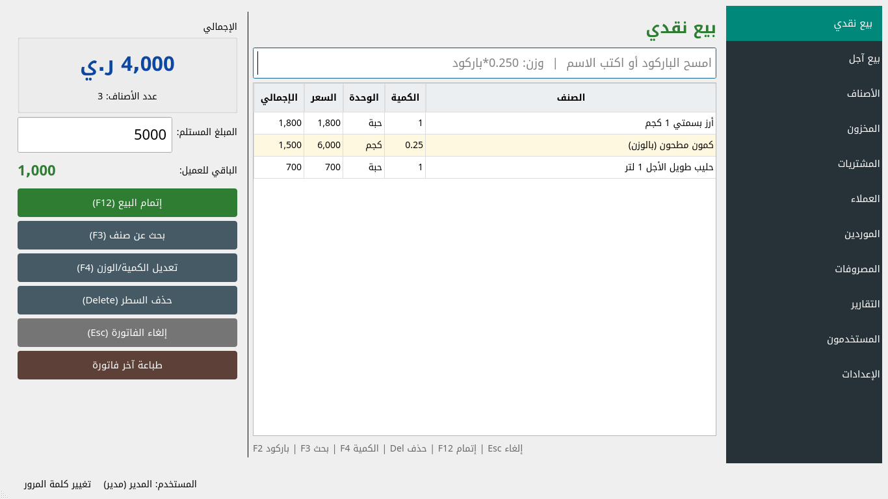
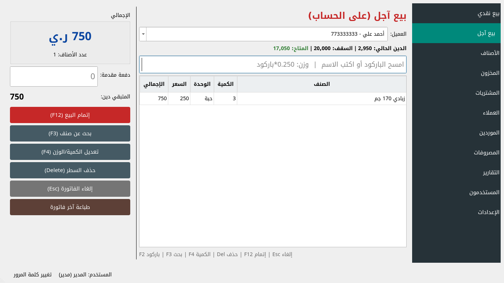
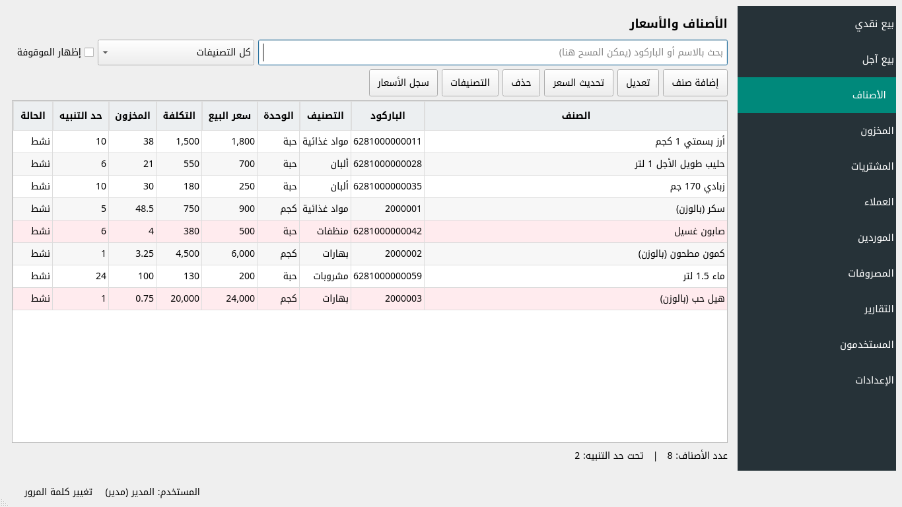
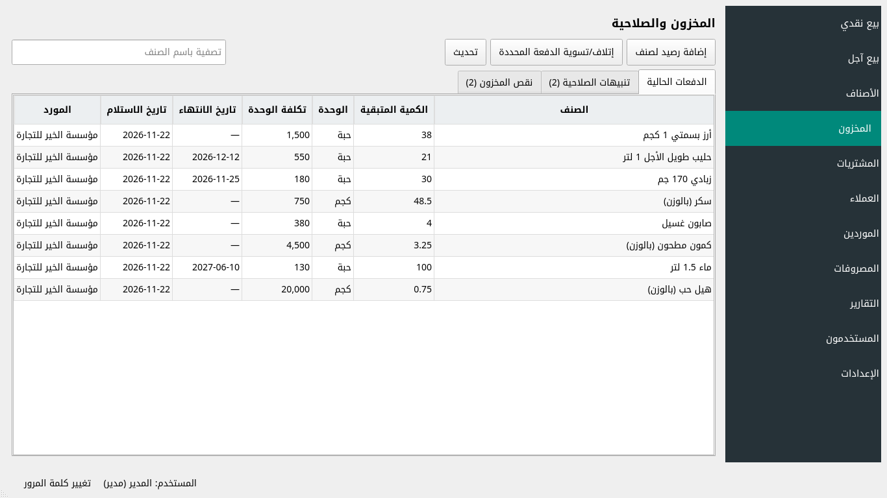
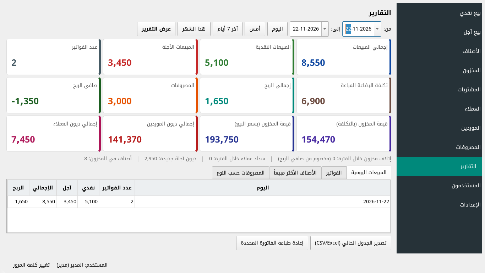
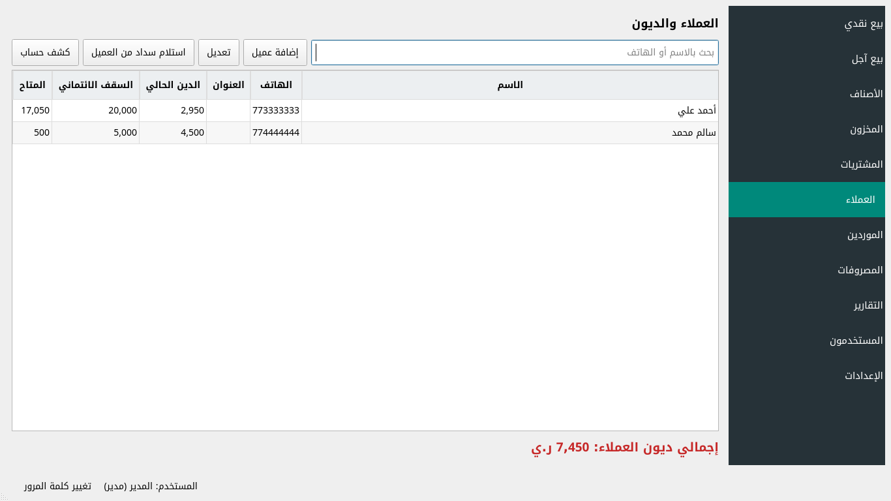
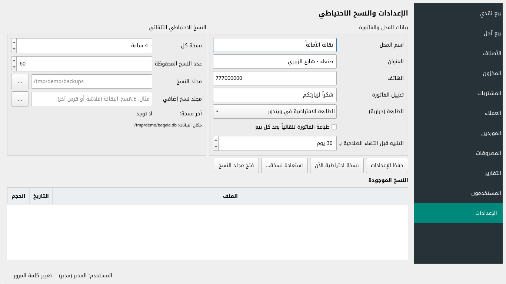

# نظام البقالة - كاشير ومخزون (BaqalaPOS)

نظام نقطة بيع ومخزون عربي لمحلات البقالة، يعمل على ويندوز **بدون إنترنت**، بالعملة **الريال اليمني (ر.ي)**.



## المزايا

| القسم | ما يقدمه |
|---|---|
| البيع النقدي / الآجل | صفحتان منفصلتان، قارئ باركود USB، المبلغ المستلم والباقي، طباعة فاتورة حرارية 80 مم |
| البيع بالوزن | كميات حتى 3 منازل عشرية (`0.250` كجم) ويُحسب السعر تلقائياً. صيغة سريعة: `0.250*الباركود` |
| الأصناف | إضافة/تعديل/حذف، تصنيفات، بحث بالاسم أو الباركود أو التصنيف، سجل تغيّر الأسعار |
| المخزون والصلاحية | دفعات بتاريخ انتهاء، صرف **FEFO** (الأقرب انتهاءً أولاً)، منع بيع المنتهي، تنبيهات المنتهي والقريب والنقص |
| العملاء والموردون | الديون والسداد وكشف الحساب، **سقف ائتماني** يمنع البيع الآجل عند تجاوزه |
| المشتريات والمصروفات | فاتورة شراء نقدية/آجلة تضيف دفعات للمخزون، مصروفات حسب النوع |
| التقارير | المبيعات (نقدي/آجل)، تكلفة البضاعة، الربح الإجمالي والصافي، المصروفات، **قيمة المخزون**، **ديون الموردين** والعملاء، الأكثر مبيعاً، تصدير CSV |
| الصلاحيات | مدير (كل شيء) وموظف كاشير (البيع، عرض الأصناف، العملاء وسدادهم) |
| النسخ الاحتياطي | تلقائي دوري + عند الإغلاق، تدوير، نسخة إضافية لفلاشة، استعادة بنقرة |

## البنية التقنية

- **Python 3.10+ و PyQt5**: اخترت PyQt5 بدل Tkinter لأن دعم RTL والعربية فيه أصلي (`setLayoutDirection`)، وجداوله سريعة مع آلاف الأصناف، ويوفر طباعة مباشرة للطابعات الحرارية (`QPrinter`).
- **SQL Server** (قاعدة البيانات الأساسية، اسمها `BaqalaPOS`) عبر ODBC و`pyodbc`. يكفي **SQL Server Express** المجاني على جهاز المحل، ويمكن أن تتصل به عدة أجهزة كاشير في الشبكة المحلية.
- **SQLite** (احتياطي): ملف محلي بدون خادم، لجهاز لا يوجد عليه SQL Server. يُختار من الإعدادات.
- **PyInstaller + Inno Setup**: لإنتاج `BaqalaPOS-Setup.exe` بنقرة واحدة.

```
main.py                 نقطة التشغيل
baqala/
  money.py              Decimal: المبالغ بدقة 0.01 والكميات بدقة 0.001 (رفض float)
  db.py                 المعاملات وفتح القاعدة حسب الإعداد، ومخطط SQLite (WAL + synchronous=FULL)
  mssql.py              الاتصال بـ SQL Server، الإنشاء والترحيل التلقائي، النسخ .bak والاستعادة
  sql/BaqalaPOS_SQLServer.sql  سكربت T-SQL الكامل لقاعدة BaqalaPOS
  transfer.py           نقل البيانات من SQLite إلى SQL Server
  config.py             مكان البيانات وإعداد الاتصال database.ini (خارج مجلد البرنامج)
  scan.py textnorm.py   كشف قارئ الباركود وتطبيع النص العربي
  services/             منطق الأعمال (بدون واجهة): auth products inventory sales
                        parties purchases expenses reports backup settings
  ui/                   صفحات PyQt5
tests/                  اختبارات pytest
installer/BaqalaPOS.iss ملف المثبت
baqala.spec             إعداد PyInstaller
```

### قاعدة البيانات وسلامة البيانات

- المبالغ تُخزن كأعداد صحيحة بوحدة 1/100 ريال، والكميات بوحدة 1/1000، وكل الحسابات بـ `Decimal` — لا توجد أخطاء تقريب float.
- الجداول: `products` `categories` `batches` (دفعات بتاريخ انتهاء وتكلفة) `sales` `sale_items` `sale_item_batches` (من أي دفعة صُرف كل سطر) `customers` `suppliers` `customer_payments` `supplier_payments` `purchases` `expenses` `stock_adjustments` `price_history` `users` `settings`.
- كل عملية (بيع، شراء، سداد، إتلاف) تتم في **معاملة واحدة**: إن انقطعت الكهرباء في منتصفها لا يُحفظ منها شيء. في SQL Server بـ `XACT_ABORT ON` وسجل المعاملات، وفي SQLite بـ `journal_mode=WAL` و `synchronous=FULL`.
- في SQL Server كل عملية كتابة تأخذ قفلاً على مستوى التطبيق (`sp_getapplock`)، فلا يبيع جهازا كاشير نفس الدفعة أو يتجاوزان السقف الائتماني معاً.
- مخطط SQL Server: ترميز عربي `Arabic_CI_AS`، مفاتيح أجنبية، قيود `CHECK` على المبالغ والكميات، باركود فريد، فهارس للبحث وFEFO والتقارير، و`READ_COMMITTED_SNAPSHOT` حتى لا تُبطئ التقارير البيع.
- الصنف الذي له حركات لا يُحذف فعلياً بل يُوقف، حتى تبقى التقارير صحيحة.
- الربح يُحسب من **تكلفة الدفعة الفعلية** التي صُرفت (وليس متوسطاً تقديرياً).

## التشغيل من الكود (للتطوير أو التجربة)

```bat
python -m pip install -r requirements-dev.txt
python main.py
```

أول دخول: المستخدم `admin` وكلمة المرور `admin`، وسيُطلب تغييرها فوراً.

لتجربة النظام ببيانات وهمية في مجلد منفصل (لا يمس بيانات المحل):

```bat
set BAQALA_DATA_DIR=C:\baqala_demo
python scripts\seed_demo.py
python main.py
```

الاختبارات:

```bat
python -m pytest -q
```

تغطي: الحسابات المالية والتقريب، FEFO واستبعاد المنتهي، السقف الائتماني، خصم المخزون والتراجع الكامل عند الفشل، الصلاحيات، التقارير، النسخ والاستعادة، كشف الباركود، واختبار دخان للواجهة.

لتشغيل الاختبارات نفسها على SQL Server أيضاً (كل اختبار يعمل على المحركين): عرّف `BAQALA_TEST_MSSQL_SERVER` و`BAQALA_TEST_MSSQL_USER` و`BAQALA_TEST_MSSQL_PASSWORD`، و`BAQALA_TEST_MSSQL_SHARE` لمجلد يراه الخادم لاختبار ملفات `.bak`. ويشغّلها `.github/workflows/sqlserver-tests.yml` تلقائياً.

## بناء ملف التثبيت

**الطريقة 1 — تلقائياً عبر GitHub Actions:** كل دفع إلى المستودع يشغّل `.github/workflows/windows-build.yml` على ويندوز: الاختبارات ← PyInstaller ← Inno Setup، ويرفع `BaqalaPOS-Setup-1.0.0.exe` كـ Artifact في صفحة التشغيل.

**الطريقة 2 — على جهاز ويندوز:**

1. ثبّت [Python 3.11](https://www.python.org/downloads/windows/) (فعّل *Add to PATH*) و [Inno Setup 6](https://jrsoftware.org/isdl.php).
2. شغّل `build_windows.bat` من مجلد المشروع.
3. الناتج: `Output\BaqalaPOS-Setup-1.0.0.exe`.

ما يفعله: `pyinstaller baqala.spec` ينتج مجلد `dist\BaqalaPOS` فيه `BaqalaPOS.exe` و Python و Qt (لا يحتاج جهاز المحل تثبيت Python). ثم `ISCC installer\BaqalaPOS.iss` يجمعه في مثبت عربي.

## قاعدة البيانات SQL Server

1. ثبّت **SQL Server 2022 Express** (مجاني) على جهاز المحل باسم المثيل الافتراضي `SQLEXPRESS`، مع **Microsoft ODBC Driver 18 for SQL Server** (إن لم يوجد يستخدم البرنامج تعريف «SQL Server» المدمج في ويندوز).
2. عند أول تشغيل يتصل البرنامج بـ `.\SQLEXPRESS` بحساب ويندوز الحالي، و**ينشئ قاعدة `BaqalaPOS` وكل جداولها تلقائياً**. وإن لم يجد الخادم تظهر نافذة «إعداد قاعدة البيانات».
3. الإعداد يُغيَّر من **الإعدادات ← قاعدة البيانات...**: الخادم، اسم القاعدة، الدخول بحساب ويندوز أو بمستخدم SQL، أو اختيار SQLite. زر «اختبار الاتصال» يتحقق قبل الحفظ.
4. إن كانت على الجهاز بيانات SQLite سابقة وقاعدة SQL Server فارغة، يعرض البرنامج **نقل كل البيانات** إليها في معاملة واحدة مع التحقق من عدد السجلات.
5. الإعداد محفوظ في `C:\ProgramData\BaqalaPOS\database.ini`، وكلمة مرور مستخدم SQL مشفرة بـ Windows DPAPI.
6. **عدة أجهزة كاشير:** على كل جهاز اجعل الخادم `اسم-جهاز-الخادم\SQLEXPRESS`، وفعّل TCP/IP في SQL Server Configuration Manager، واسمح بالمنفذ في جدار الحماية.

لإنشاء القاعدة يدوياً (اختياري): `sqlcmd -S .\SQLEXPRESS -E -i baqala\sql\BaqalaPOS_SQLServer.sql`.

## التثبيت في المحل

1. شغّل `BaqalaPOS-Setup-x.y.z.exe` واضغط تثبيت (يطلب صلاحية المسؤول مرة واحدة).
2. يُنشأ اختصار على سطح المكتب وقائمة ابدأ.
3. ادخل بـ `admin` / `admin` وغيّر كلمة المرور، ثم من **الإعدادات** أدخل اسم المحل والهاتف واختر الطابعة الحرارية.
4. من **المستخدمون** أنشئ حساباً للكاشير بصلاحية «موظف».
5. أضف الأصناف ثم أدخل المخزون عبر **المشتريات** (أو «إضافة رصيد» في صفحة المخزون) مع تواريخ الانتهاء.

**التحديث:** شغّل مثبت النسخة الجديدة فوق القديمة. **البيانات لا تُمس** لأنها محفوظة في `C:\ProgramData\BaqalaPOS` وليس في مجلد البرنامج، والمزيل مُعد بحيث لا يحذف هذا المجلد. عند تغيّر بنية قاعدة البيانات في إصدار جديد يرحّلها البرنامج تلقائياً عند أول تشغيل.

## النسخ الاحتياطي التلقائي

- كل 10 دقائق يفحص البرنامج: إن مرت المدة المحددة (افتراضياً **4 ساعات**) منذ آخر نسخة، ينشئ نسخة جديدة. كما ينشئ نسخة عند فتح البرنامج (إن حان الموعد) وعند إغلاقه.
- **SQL Server:** نسخة كاملة `BACKUP DATABASE ... WITH CHECKSUM` بملف `.bak` ثم `RESTORE VERIFYONLY`. خدمة SQL Server هي التي تكتب الملف، لذلك يجب أن يكون مجلد النسخ على جهاز الخادم (المثبت يمنحها صلاحية الكتابة في المجلد الافتراضي).
- **SQLite:** نسخة بـ **Online Backup API** متسقة حتى أثناء البيع، ثم يُفحص الملف بـ `integrity_check`.
- المكان الافتراضي: `C:\ProgramData\BaqalaPOS\backups\baqala_YYYYMMDD_HHMMSS_auto.bak` (أو `.db`)، ويُحتفظ بآخر 60 نسخة وتُحذف الأقدم.
- يُنصح بتحديد **مجلد نسخ إضافي** على فلاشة أو قرص آخر من الإعدادات، فتُنسخ كل نسخة إليه أيضاً.
- **الاستعادة:** الإعدادات ← اختر النسخة ← «استعادة نسخة». يحفظ البرنامج نسخة أمان من البيانات الحالية أولاً، ثم يستبدلها ويعيد التشغيل.

## استخدام الكاشير

| المفتاح | العمل |
|---|---|
| مسح الباركود | يضيف الصنف (مسح نفس الصنف مرة أخرى يزيد الكمية) |
| `0.250*باركود` ثم Enter | يضيف 0.250 كجم من صنف بالوزن (أو `3*باركود` لثلاث حبات) |
| F2 | التركيز على حقل الباركود |
| F3 | بحث عن صنف بالاسم |
| F4 | تعديل الكمية / الوزن للسطر المحدد |
| Delete | حذف السطر |
| F12 | إتمام البيع |
| Esc | إلغاء الفاتورة |

قارئ الباركود يعمل حتى لو كانت لغة لوحة المفاتيح عربية، وحتى لو كان المؤشر في حقل آخر من صفحة البيع.

## ملاحظات

- مكان الملفات: `C:\ProgramData\BaqalaPOS\` (`baqala.db` ونسخها، `backups\`، `logs\app.log`).
- لا يُسمح بفتح البرنامج مرتين على نفس الجهاز لتجنب التعارض.

## صور

| | |
|---|---|
|  |  |
|  |  |
|  |  |
